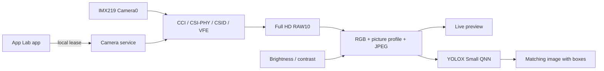

# Development and releases

This package contains source code. Build the driver on a supported target Ventuno Q
with matching kernel headers. No prebuilt kernel module for other machines is published.

## Verification and tests without a camera

```bash
python3 scripts/package.py verify
bash scripts/test.sh
```

NumPy, Pillow, and a C compiler must be available in the environment.
The tests build only the RGB library and check CPU processing, picture settings,
boot menu generation, and rollback helpers. They do not start a camera or load a
module, and do not modify `/boot` or `/etc`. On macOS, a separate Python environment
with NumPy/Pillow may be needed.

GitHub Actions runs source and processing tests on Ubuntu 24.04. This is not a
hardware test of CAMSS, CSI, IMX219, or QNN.

`SHA256SUMS` checks packaged source files for changes. It provides integrity
verification, not a digital signature. `.build/build.json` ties the built module
and RGB library to that manifest. The driver must also have the known source
version and correct kernel ABI.

## Building on the Ventuno Q

```bash
bash scripts/build.sh
```

Build products: `.build/driver/qcom-camss.ko` and `runtime/picture_native.so`.
Building does not change the active driver or boot selection. The patches in
`driver/patches` are already applied in `driver/camss`; do not apply them again.

## After changes and before a release

Update tests and documentation, then deliberately generate a new source manifest:

```bash
python3 scripts/package.py manifest
bash scripts/test.sh
python3 scripts/package.py release
```

Rebuild the driver on the board when executable source code has changed.
`dist/` contains the source archive, App Lab ZIP, and `SHA256SUMS`. The app ZIP
contains `app.yaml`, `python/`, and `assets/` directly at its root. Compiler outputs,
`.build`, local recordings, personal boot DTBs, and Git history are excluded from
the source archive.

Give each release a new number in `VERSION` and record the checks performed.
Mark an `-rc` version as a pre-release. Publish a final `1.0.0` only after checking
the complete installation from a fresh, supported boot. Do not claim a second-board
or cold-boot test that has not been performed.

## Architecture



The service accepts limited actions through a local Unix socket and checks the
sender's UID. It starts protected code under `/opt`. Picture controls change RGB
processing, not camera registers. The service does not unload or replace a
loaded CAMSS module.
