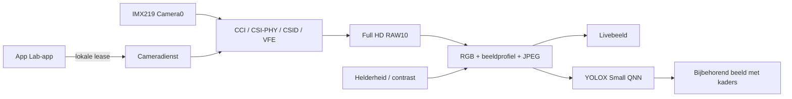

# Ontwikkelen en releases

Het pakket bevat broncode. Bouw de driver op de ondersteunde doel-Ventuno Q met
de passende kernelheaders. Er wordt geen vooraf gebouwde kernelmodule voor
andere machines gepubliceerd.

## Controle en tests zonder camera

```bash
python3 scripts/package.py verify
bash scripts/test.sh
```

NumPy, Pillow en een C-compiler moeten in de gebruikte omgeving beschikbaar zijn.
De tests bouwen alleen de RGB-bibliotheek en controleren CPU-verwerking,
beeldinstellingen, bootmenugeneratie en herstelhelpers. Geen camera of module
wordt gestart en `/boot` en `/etc` worden niet gewijzigd. Op macOS kan een aparte
Python-omgeving met NumPy/Pillow nodig zijn.

GitHub Actions voert bron- en verwerkingstests op Ubuntu 24.04 uit. Dat is geen
hardwaretest van CAMSS, CSI, IMX219 of QNN.

`SHA256SUMS` controleert verpakte bronbestanden op wijzigingen. Dit is een
integriteitscontrole, geen digitale handtekening. `.build/build.json` koppelt de
gebouwde module en RGB-bibliotheek aan dat manifest. De driver moet daarnaast
de bekende bronversie en juiste kernel-ABI hebben.

## Op de Ventuno Q bouwen

```bash
bash scripts/build.sh
```

Bouwproducten: `.build/driver/qcom-camss.ko` en `runtime/picture_native.so`.
Bouwen verandert geen actieve driver of bootkeuze. De patches in `driver/patches`
zijn al verwerkt in `driver/camss`; pas ze niet opnieuw toe.

## Na wijzigingen en voor een release

Werk tests en documentatie bij en genereer bewust een nieuw bronmanifest:

```bash
python3 scripts/package.py manifest
bash scripts/test.sh
python3 scripts/package.py release
```

Bouw de driver opnieuw op het board als uitvoerbare broncode is gewijzigd.
`dist/` bevat bronarchief, App Lab-ZIP en `SHA256SUMS`. De app-ZIP bevat
`app.yaml`, `python/` en `assets/` direct in de hoofdmap. Compilerproducten,
`.build`, lokale opnamen, persoonlijke boot-DTB's en Git-geschiedenis worden
niet in het bronarchief opgenomen.

Geef iedere release een nieuw nummer in `VERSION` en leg uitgevoerde controles
vast. Markeer een `-rc`-versie als pre-release. Maak een definitieve `1.0.0` pas
na controle van de volledige installatie vanaf een schone, ondersteunde boot.
Claim geen tweede-board- of koude-boottest die niet is uitgevoerd.

## Architectuur



De dienst accepteert beperkte acties via een lokale Unix-socket en controleert
de UID van de afzender. Hij start beschermde code onder `/opt`. Beeldregelaars
wijzigen de RGB-verwerking, geen cameraregisters. De dienst verwijdert of
vervangt geen geladen CAMSS-module.
